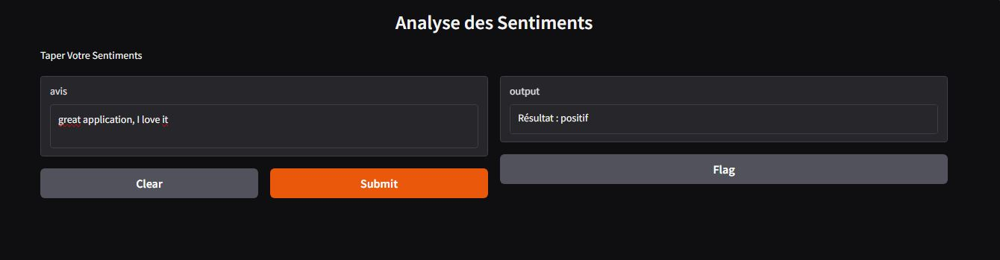

# Sentiment Analysis of Amazon Reviews with Machine Learning

A machine learning project that classifies Amazon app reviews as **positive** or **negative** using **TF-IDF** and **Logistic Regression**, with an interactive web interface built with **Gradio**.

## Demo

## Features

- Text cleaning (lowercasing, special character removal, stopword removal)
- TF-IDF vectorization
- Logistic Regression classifier
- Evaluation with classification report and confusion matrix
- Interactive Gradio interface for real-time predictions

## Tech Stack

- Python 3.12
- pandas
- scikit-learn
- Gradio
- Jupyter Notebook (VS Code)

## Dataset

The project uses a dataset of **19,996** Amazon app reviews, each labeled as positive or negative. The data is split into **80% training** and **20% testing** (`random_state=42`).

### Example inputs

| Review | Expected result |
|---|---|
| `great application, I love it` | positif |
| `this game is awesome and really fun` | positif |
| `worst app ever, it crashes all the time` | négatif |

